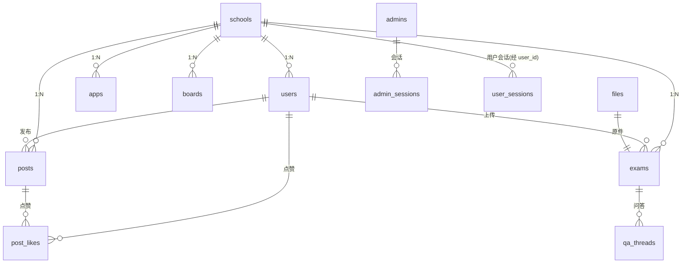

# 01 · 架构设计

> 读者：技术负责人、全体开发、运维。回答“系统怎么分、怎么连、为什么这样选”。
> 详细到接口字段、表字段、错误码的施工图在 [02-详细设计](02-详细设计.md)。

## 1. 上下文与边界

### 1.1 业务上下文

校内网 2.0 是一个多角色 B/S Web 应用：

- **游客**：按学校阅读工具、真题列表、社区帖子；
- **学生**：注册（需审核）→ 登录 → 上传/下载真题、发帖点赞、就真题提问、维护个人资料；
- **管理员**：平台级账号，密码 + 动态码登录，选择当前管理学校，审核注册与真题、管理社区与纠错。

外部依赖：

| 依赖 | P0 用法 | 说明 |
|---|---|---|
| 腾讯身份验证器 | 管理员扫码绑定标准 TOTP | 微信小程序，兼容 RFC 6238 otpauth |
| 校园邮箱 | 注册时校验域名 | P0 不真实发信；找回密码走管理员 |
| 文件系统 | 真题原件 | `server/uploads`，必须在 `web/` 之外 |
| MySQL 8 | 全部业务数据 | 会话也存 MySQL |

### 1.2 明确不做（P0 边界）

- 不接入真实邮件服务、短信服务；
- 不接入真实大模型，真题问答是规则生成演示；
- 不做评论、收藏、帖子编辑；页面会明确提示“P1 未实现”；
- 不做多管理员角色 / 超级管理员分级；
- 不做微服务、消息队列、Redis；单机部署足够课程闭环。

不做不是偷懒，而是把“注册 → 审核 → 登录 → 上传 → 审核 → 下载”主链路做稳。

## 2. 逻辑架构

```text
┌──────────────┐
│  浏览器       │  HTML/CSS/ES Module
└──────┬───────┘
       │ 同源 HTTPS / HTTP
┌──────▼─────────────────────────────────────────────┐
│ Nginx（唯一公网入口）                                │
│  ├─ /              静态文件 web/                     │
│  ├─ /assets/*      静态 CSS/JS                       │
│  ├─ /api/*         反向代理 → 127.0.0.1:3100         │
│  └─ /__files/*     internal，只接受 X-Accel-Redirect │
└──────┬─────────────────────────────────────────────┘
       │
┌──────▼─────────────────────────────────────────────┐
│ Express 5（只监听 127.0.0.1）                        │
│  middleware：请求 id → 日志 → 安全头 → JSON → Cookie │
│              → CSRF → 用户/管理员会话 → 鉴权 → 路由  │
│  modules：auth / admin-auth / home / apps / exams /  │
│           qa / posts / profile / admin               │
│  service：业务规则、事务                             │
│  db：mysql2 连接池（上限 10）                        │
└──────┬─────────────────────────────────────────────┘
       │
┌──────▼─────────────────────────────────────────────┐
│ MySQL 8                                             │
│  schools / users / admins / user_sessions /          │
│  admin_sessions / apps / files / exams / boards /    │
│  posts / post_likes / qa_threads / corrections /     │
│  audit_logs / password_reset_requests                │
└────────────────────────────────────────────────────┘
```

### 2.1 分层与依赖方向

```text
routes（HTTP、参数、响应）
  ↓ 只调用
service（业务规则、事务边界）
  ↓ 使用
db / pool（SQL、连接池）
```

- 路由不写复杂 SQL，不拼业务规则；
- service 不读写 `req/res`；
- 所有错误抛 `AppError`，由统一 `errorHandler` 变成 JSON；
- 前端只通过 `web/assets/js/api.js` 发请求。

### 2.2 三类请求

| 类型 | 示例 | 谁处理 |
|---|---|---|
| 页面 | `GET /exam-lib.html` | Nginx 直接读 `web/` |
| 接口 | `GET /api/exams?schoolId=1` | Nginx → Express → MySQL |
| 文件 | `GET /api/exams/1/download` | Express 鉴权，Nginx 发文件（生产）或 Express `sendFile`（本地） |

## 3. 部署架构

### 3.1 本地一键全栈（Docker Compose）

```text
宿主机 8088 ── nginx 容器 ── /usr/share/nginx/html（挂载 web/）
                   │
                   └─ /api → api:3100（Express 容器）
                                   │
                                   └─ mysql:3306（MySQL 容器）
宿主机 3308 ── mysql 容器（便于用客户端检查）
```

- 前端静态文件由 Nginx 容器提供；
- API 与 MySQL 不直接暴露给公网；
- 数据卷 `campus2_mysql_data` 持久化；
- `docker compose down -v` 会清空演示数据。

### 3.2 单机生产

```text
公网 443 ── Nginx（TLS 终止、HSTS、静态、反代）
                ├─ 127.0.0.1:3100  Express（systemd 托管）
                ├─ 127.0.0.1:3306  MySQL 8（只监听本机）
                └─ /srv/campus2.0/shared/uploads（Nginx internal alias）
```

- `current` 是指向某个 release 的软链接，回滚就是切换软链接；
- `.env` 放在 `/srv/campus2.0/.env`，不在发布目录内；
- 上传目录在 `shared/`，所有 release 共享；
- systemd 直接 `ExecStart=/usr/bin/node src/server.js`，不经过 npm；
- 日志：Nginx access/error、journalctl、MySQL 慢查询、`audit_logs` 表。

### 3.3 端口与网络

| 组件 | 监听 | 是否暴露公网 |
|---|---|---|
| Nginx | 8088（本地）/ 80、443（生产） | 是（唯一入口） |
| Express | 127.0.0.1:3100 | 否 |
| MySQL | 3308（本地 Docker）/ 3306（生产） | 否 |

## 4. 数据架构

### 4.1 核心关系



### 4.2 学校隔离的物理基础

- `schools` 是根节点；
- 每张业务表都有 `school_id`；
- 能组合外键的地方使用组合外键：
  - `files (uploader_id, school_id) → users (id, school_id)`；
  - `exams (file_id, school_id) → files (id, school_id)`；
  - `posts (board_id, school_id) → boards (id, school_id)`；
  - `post_likes (post_id, school_id) → posts (id, school_id)`。
- 这样即使业务代码写错，数据库也不允许“中山大学的帖子挂到华工的版块”。

### 4.3 会话归属

- `user_sessions.user_id`：学生（学校级）；
- `admin_sessions.admin_id`：管理员（平台级）；
- 管理员会话额外存 `currentSchoolId` 与 `stage`；
- 管理员表不挂 `school_id`，通过会话中的当前学校实现“平台账号、学校级操作”。

## 5. 安全架构

### 5.1 认证

| 角色 | 认证方式 |
|---|---|
| 学生 | 校园邮箱/学号 + 密码；注册后 `pending`，管理员审核后 `active` |
| 管理员 | 密码 + TOTP（腾讯身份验证器）；首次登录强制改密 + 绑定；恢复码兜底 |

密码：Node 内置 `scrypt`，每用户随机盐，格式 `scrypt$N$r$p$salt$hash`，恒定时间比较。
TOTP 密钥：AES-256-GCM 可逆加密（验证时必须解密）；密码只存单向哈希，两者不混用。

管理员登录状态机：

```text
POST 密码
   ├─ 未绑定/未改密 → setup_required → 扫码 + 新密码 + 动态码 → active
   └─ 已绑定        → totp_required  → 6 位动态码 → active
恢复码 ─────────────► 作废旧 TOTP，强制重新绑定 → setup_required
```

TOTP 防重放：数据库记录 `last_totp_step`；时间步不大于上次的码直接拒绝，并用原子 UPDATE 防止并发重放。

### 5.2 会话

- Cookie 里只放随机 sid；服务端 MySQL 存会话数据；
- `campus_sid` = 学生；`campus_admin_sid` = 管理员；
- 两套 Cookie、两套 Store、两套密钥；
- sid 入库前 SHA-256 哈希；
- 登录时 `regenerate()` 防会话固定；
- 改密/禁用/停用学校会删会话，立即生效；
- 管理员 30 分钟无操作过期；学生默认 12 小时，勾“记住我”7 天。

### 5.3 CSRF

双提交：

- `GET /api/csrf` 下发非 HttpOnly 的 `campus_csrf` Cookie，并返回同一个 token；
- 所有 POST/PATCH/DELETE 必须带 `X-CSRF-Token`，与 Cookie 相等；
- 前端 `api.js` 自动获取并携带；令牌过期自动清缓存重试一次；
- 跨站请求拿不到页面里的 token，即使浏览器自动带 Cookie 也无法伪造请求头。

### 5.4 学校隔离 / 越权

- 学生学校来自 `req.user.schoolId`（会话 + 每次查库复查），不来自 URL；
- 管理员学校来自 `req.session.currentSchoolId`，切换走专门接口并写审计；
- 每一条业务查询都带 `school_id`；
- 跨校资源统一返回 404，不返回 403，避免暴露“存在但无权”；
- 关键后台操作写 `audit_logs`。

### 5.5 文件

- 只看扩展名不够，后端读文件头魔数（PDF/JPG/PNG）；
- 存储名用 UUID，原始文件名只入库；
- 文件目录在 `web/` 之外；
- 下载必须登录且同校；待审核文件仅上传者可下载；
- 生产 `X-Accel-Redirect` + Nginx `internal`，Node 只做门卫。

### 5.6 其他

- 登录/注册/上传/问答限流（内存固定窗口；多实例需换 Redis）；
- 用户/管理员密码失败 5 次锁定 15 分钟；
- 安全响应头：`X-Content-Type-Options`、`X-Frame-Options`、Referrer-Policy、CSP；
- 生产 HTTPS + HSTS + Secure Cookie + `trust proxy`；
- 审计日志不记录密码、动态码、恢复码。

## 6. 关键架构决策（ADR）

### ADR-01 原生前端，无框架无打包

- 决策：纯 HTML/CSS/ES Module。
- 理由：教学透明、零构建，浏览器直接加载源码。
- 代价：状态管理与组件复用要手写；页面多了会重复。
- 替代：Vue/React + Vite，适合页面和状态复杂度超过手工同步临界点之后。

### ADR-02 密码哈希使用内置 scrypt

- 决策：`node:crypto` 的 scrypt，而不是 argon2id。
- 理由：Node 内置，Windows 不需要原生编译；scrypt 仍是内存硬哈希，安全性可接受。
- 代价：参数调优与生态不如 argon2id 丰富；生产如能稳定编译，优先 argon2id。
- 替代：argon2id + pepper。

### ADR-03 会话存 MySQL，不用 JWT

- 决策：`express-session` + 自定义 MySQL Store。
- 理由：可撤销；管理员 TOTP 阶段、当前学校、30 分钟过期都需要服务端状态。
- 代价：每次请求查库；会话表需要清理。
- 替代：Redis 会话 / 短效 JWT + refresh token。

### ADR-04 本地 Express 发文件，生产 X-Accel

- 决策：`USE_X_ACCEL=false` 时 `res.sendFile`；生产 `true` 时只返回 `X-Accel-Redirect`。
- 理由：本地少一层配置；生产大文件不占 Node 内存与事件循环。
- 代价：生产必须成对配置 Nginx `/__files/` 的 `internal` + `alias`。

### ADR-05 管理员是平台账号，会话保存当前学校

- 决策：`admins` 不挂学校；登录时选择学校，写入 `currentSchoolId`。
- 理由：课程要求“后台按学校隔离”，同时避免管理员账号散落在各校。
- 代价：管理员必须每次显式选择/切换学校；所有后台查询依赖会话中的当前学校。
- 替代：每校独立管理员账号 + `admins.school_id`。

### ADR-06 找回密码走管理员，不接邮件

- 决策：提交找回申请 → 管理员核实 → 生成一次性临时密码。
- 理由：没有邮件服务/短信供应商；避免假装发信。
- 代价：人工处理，不适合大规模。
- 替代：邮箱验证码 / Magic Link / 短信。

### ADR-07 真题问答是规则演示

- 决策：后端根据关键词生成固定回答，明确标注“演示版”，不冒充真实 AI。
- 理由：P0 不引入模型成本与密钥管理；链路（登录 → 提问 → 落库 → 渲染）完整。
- 代价：回答质量有限。
- 替代：接入真实大模型 + 知识库检索（RAG）。

## 7. 非功能设计与风险

| 维度 | 目标 | 现状 |
|---|---|---|
| 性能 | 首页 2 秒内 | 单机、连接池 10、首页 3 条并发查询；索引覆盖学校+状态+时间 |
| 安全 | 登录、会话、越权、文件 | CSRF、双会话、TOTP、组合外键、魔数校验、审计 |
| 可用性 | 99.5% | 单机；systemd 自动重启；健康检查；备份脚本 |
| 兼容性 | Chrome/Edge | 原生 ES Module；冒烟测试使用 Edge |
| 可维护性 | 能讲清楚 | 模块化、中文注释、迁移文件、逐行讲解文档 |
| 合规 | 隐私最小化 | 仓库不写真名/学号；演示账号虚构；审计不记敏感值 |

已知风险：

1. 内存限流是单机方案，多实例会失效；
2. 单机 MySQL 无高可用；
3. TOTP 密钥加密密钥丢失后，所有管理员需重新绑定；
4. 管理员平台账号若被盗，攻击者仍需动态码，但恢复码流程需要重点保护；
5. 生产 CSP 与静态缓存配置需随页面资源版本调整。
