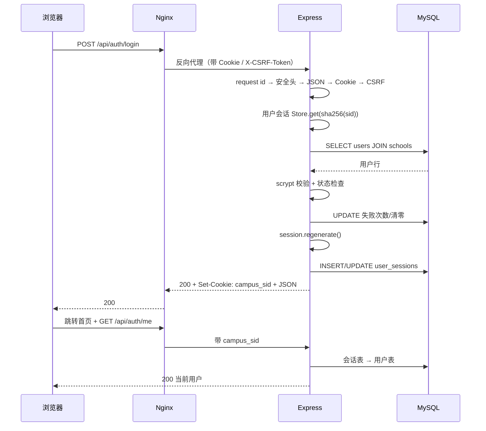
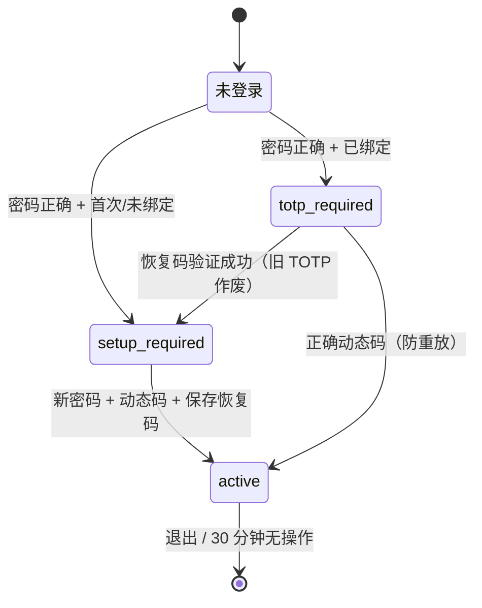
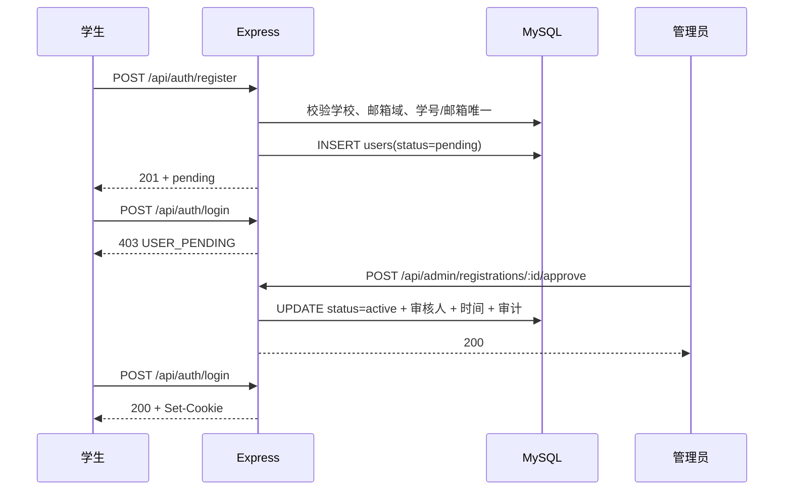

# 02 · 详细设计

> 读者：开发与测试。回答“每个模块怎么实现、接口长什么样、失败怎么办”。
> 接口全表见 [03-接口文档](03-接口文档.md)，DDL 见 [04-数据库设计](04-数据库设计.md)。

## 1. 模块与职责

### 1.1 后端

| 文件 | 职责 |
|---|---|
| `server/src/app.js` | 中间件装配、路由挂载、404、错误出口 |
| `server/src/server.js` | 启动前检查数据库、监听 127.0.0.1、优雅退出 |
| `server/src/config/env.js` | 环境变量读取、生产必填校验、TOTP 密钥格式校验 |
| `server/src/db/pool.js` | mysql2 连接池、`query` / `queryOne` / `withTransaction` |
| `server/src/middleware/request-id.js` | `X-Request-Id`、每请求一行日志 |
| `server/src/middleware/security.js` | CSP、nosniff、frame、referrer、permissions |
| `server/src/middleware/csrf.js` | 双提交令牌：`/api/csrf` 与写请求校验 |
| `server/src/middleware/session.js` | 两套 `express-session` 配置、Promise 化工具 |
| `server/src/middleware/mysql-session-store.js` | MySQL Store：sid 哈希、get/set/touch/destroy |
| `server/src/middleware/auth.js` | `attachUser` / `requireUser` / `attachAdmin` / `requireAdminActive` |
| `server/src/middleware/rate-limit.js` | 内存固定窗口限流 |
| `server/src/middleware/error.js` | 统一错误 JSON、multer/JSON 错误映射 |
| `server/src/utils/crypto.js` | scrypt 密码、sha256、AES-GCM、Base32、TOTP、恢复码 |
| `server/src/utils/files.js` | 魔数检测、UUID 落盘、Content-Disposition、X-Accel |
| `server/src/utils/serializers.js` | DB snake_case → 前端 camelCase；日期 ISO |
| `server/src/utils/school.js` | 登录用户取会话学校；游客取 `?schoolId=` 并校验 |
| `server/src/utils/validate.js` | zod 校验、密码/邮箱/学号规则、分页 |
| `server/src/modules/auth/` | 注册、登录、退出、me、找回申请、改密 |
| `server/src/modules/admin-auth/` | 管理员状态机、TOTP 绑定/验证/恢复、改密 |
| `server/src/modules/home/` | 首页三块数据聚合 |
| `server/src/modules/apps/` | 工具列表/详情/纠错 |
| `server/src/modules/exams/` | 真题列表/详情/上传/下载 |
| `server/src/modules/qa/` | 真题问答（演示） |
| `server/src/modules/posts/` + `boards` | 社区版块、帖子、点赞 |
| `server/src/modules/profile/` | 个人中心、我的真题/帖子、改密 |
| `server/src/modules/admin/` | 后台审核、管理、找回处理、审计 |

### 1.2 前端

| 文件 | 职责 |
|---|---|
| `web/assets/js/api.js` | 唯一请求入口：JSON、CSRF、错误、上传进度、下载 |
| `web/assets/js/auth.js` | `/api/auth/me`、导航、学校切换、requireLogin |
| `web/assets/js/ui.js` | `el`、`mount`、toast、dialog、时间、错误文案 |
| `web/assets/js/pages/*.js` | 一页一模块 |

页面与模块对应：

```text
index.html        → home.js
login.html        → login.js
register.html     → register.js
forgot-password   → forgot-password.js
admin-login       → admin-login.js
admin-console     → admin-console.js
app-center        → app-center.js
app-detail        → app-detail.js
exam-lib          → exam-lib.js
exam-upload       → exam-upload.js
exam-qa           → exam-qa.js
community         → community.js
profile           → profile.js
guest-gate        → 纯设计规范页，无脚本
```

## 2. 一次登录的完整链路



详细步骤：

1. 表单 `submit` 第一行 `preventDefault()`；
2. `api.js` 先 `GET /api/csrf`（如果缓存没有令牌），把 token 放 `X-CSRF-Token`；
3. Nginx `location /api/` 反代到 3100；
4. Express 依次过：请求 id / 日志 / 安全头 / JSON / cookie parser / CSRF；
5. 挂载 `userSession`（学生会话），`attachUser` 复查用户状态；
6. `auth/routes.js` 做 zod 形状校验；
7. `auth/service.js` 查用户、验密、失败计数、状态检查；
8. 成功后 `req.session.regenerate()` 换新 sid，`req.session.userId = user.id`，`save()` 写 MySQL；
9. 返回 `{data:{user}}`，浏览器保存 `campus_sid`；
10. 页面跳首页，首页再请求 `/api/auth/me` 恢复登录态。

**失败站点**：CSRF 失败 403；zod 失败 422；密码错 401；pending/rejected/disabled 403；锁定 423；数据库异常 500。任何一站失败，后面的站不会执行。

## 3. 管理员登录状态机



### 3.1 首次绑定

1. `POST /api/admin/auth/login`：密码正确 → 会话 `stage=setup_required`；返回 stage；
2. 前端 `GET /api/admin/auth/setup`：后端解密 TOTP 密钥，生成 `otpauth://` URL，`qrcode` 输出 data URL；
3. 管理员用微信「腾讯身份验证器」扫码；
4. `POST /api/admin/auth/setup`：`{newPassword, code}`；
5. 后端验证动态码，事务内更新密码哈希、`must_change_password=0`、`totp_confirmed=1`、`last_totp_step`，删除旧恢复码并写入 8 个新恢复码哈希，写审计；
6. 前端显示一次性恢复码，点击进入后台。

### 3.2 日常验证

1. 密码正确 → 会话 `stage=totp_required`；
2. `POST /api/admin/auth/verify`：验证 6 位码；
3. 校验 `step > last_totp_step`；
4. 原子 `UPDATE ... WHERE last_totp_step < ?`，并发同一个码只有一个成功；
5. 重新生成会话，`stage=active`，保存 `currentSchoolId`。

### 3.3 恢复码

- 每个恢复码只存 SHA-256 哈希，`used_at` 一次性；
- 验证成功后：标记已用、生成新 TOTP 密钥、`totp_confirmed=0`、`must_change_password=1`、`last_totp_step=NULL`；
- 会话转为 `setup_required`，必须重新扫码 + 设新密码。

## 4. 注册与审核



规则：

- 邮箱必须是所选学校 `email_domain` 结尾；
- 同校学号唯一，邮箱全局唯一；
- 注册不创建会话，不能直接登录；
- 驳回原因写入 `users.reject_reason`，学生登录时显示；
- 管理员只能审核自己当前学校的学生（`school_id` 来自 `req.currentSchool.id`）。

## 5. 文件上传、审核与下载

### 5.1 上传流水线

```text
浏览器 accept/大小预检（体验）
  → Nginx client_max_body_size 21m
  → multer memoryStorage（limits 21MB）
  → zod 校验表单字段
  → file-type 魔数检查（PDF/JPG/PNG）
  → 写 uploads/UUID.ext + sha256
  → 事务：INSERT files → INSERT exams(status=pending)
  → 失败：ROLLBACK + unlink 已写文件
```

- Nginx 21m 给 multipart 留 1MB；业务上限 20MB 在 `saveUploadedFile`；
- 原始文件名只入库；存储名 UUID；禁止路径穿越；
- `files` 与 `exams` 同事务，避免“有文件没记录/有记录没文件”。

### 5.2 审核

- 管理员 `SELECT ... FOR UPDATE` 锁住真题行；
- 检查当前状态必须是 `pending`，防止重复审核；
- 更新 `status/review_note/reviewed_by/reviewed_at`；
- 同事务写 `audit_logs`。

### 5.3 下载

1. `requireUser`：登录、用户 active、学校 active；
2. 按 `id + school_id` 查（跨校 404）；
3. 权限：上传者本人可下载任意状态；其他人只能下载 `approved`；
4. `download_count + 1`；
5. 本地 `res.sendFile`；生产返回 `X-Accel-Redirect: /__files/<storage_key>`；
6. Nginx `internal` + `alias` 发文件，外部不能直接访问 `/__files/`。

## 6. 其他业务

### 6.1 首页

- 登录用户：学校来自 `req.user.schoolId`；
- 游客：必须带 `?schoolId=`，只返回公开内容；
- 一次 `Promise.all` 并发查工具、真题、帖子 + 三个计数；
- 状态过滤：apps active、exams approved、posts published。

### 6.2 社区

- 版块按学校隔离；
- 发帖：标题 4–160 字，正文 1–5000 字；
- 点赞：事务内 `SELECT ... FOR UPDATE` 锁帖子，再增删 `post_likes` 并更新计数，主键 `(post_id,user_id)` 防重复；
- 游客只读。

### 6.3 真题问答

- 必须登录；
- 只能问本校可见真题（跨校 404）；
- 演示版规则回答，写入 `qa_threads`，前端 `textContent` 渲染。

### 6.4 个人中心

- 资料：昵称、学院、简介可改；学校/学历/入学年份/学号/邮箱只读；
- 改密：验证当前密码 → 新密码策略 → 更新哈希 → 删除该用户其他会话；
- 我的真题：全部状态，含驳回原因；
- 我的帖子：不显示已删除。

### 6.5 找回密码

- 游客提交学校 + 学号/邮箱 + 说明；
- 为避免枚举，无论账号是否存在都返回相同成功提示；
- 管理员生成临时密码（一次显示），更新哈希、删除用户所有会话、写审计。

## 7. 校验规则

| 字段 | 规则 |
|---|---|
| 密码 | 8–64 位，至少 1 字母 + 1 数字 |
| 邮箱 | 合法邮箱格式，且后缀匹配所选学校域名 |
| 学号 | 4–32 位，字母/数字/短横线 |
| 昵称 | 1–40 字 |
| 标题（真题） | 4–160 字 |
| 帖子标题 | 4–160 字；正文 1–5000 字 |
| 问题 | 2–500 字 |
| 纠错 | 5–500 字 |
| 文件 | ≤20MB；PDF/JPEG/PNG 魔数 |
| 动态码 | 6 位数字；±1 时间步；防重放 |
| 恢复码 | 一次性，存 SHA-256 |

## 8. 错误与状态码

| HTTP | code | 场景 |
|---|---|---|
| 400 | `JSON_INVALID` | 请求体不是合法 JSON |
| 401 | `UNAUTHENTICATED` / `AUTH_INVALID` / `ADMIN_INVALID` / `TOTP_INVALID` / `TOTP_REPLAY` / `RECOVERY_INVALID` | 未登录、密码错、动态码错/重放、恢复码错 |
| 403 | `CSRF_INVALID` / `USER_PENDING` / `USER_REJECTED` / `USER_DISABLED` / `SCHOOL_DISABLED` / `ADMIN_STAGE_REQUIRED` / `ADMIN_DISABLED` | CSRF、状态、阶段 |
| 404 | `NOT_FOUND` / `EXAM_NOT_FOUND` / `APP_NOT_FOUND` / `POST_NOT_FOUND` / `REGISTRATION_NOT_FOUND` | 不存在或跨校 |
| 409 | `AMBIGUOUS_ACCOUNT` / `EMAIL_EXISTS` / `STUDENT_NO_EXISTS` / `EXAM_ALREADY_REVIEWED` | 冲突 |
| 413 | `FILE_TOO_LARGE` | 文件 >20MB |
| 422 | `VALIDATION_FAILED` / `FILE_TYPE_INVALID` / `EMAIL_DOMAIN_INVALID` / `CURRENT_PASSWORD_INVALID`（401）/ `PASSWORD_UNCHANGED` | 字段/类型/业务规则 |
| 423 | `USER_LOCKED` / `ADMIN_LOCKED` | 连续密码错误锁定 |
| 429 | `RATE_LIMITED` | 限流 |
| 500 | `INTERNAL_ERROR` | 未处理异常，响应带 requestId |

错误响应统一：

```json
{
  "error": {
    "code": "USER_PENDING",
    "message": "账号正在等待管理员审核，请耐心等待",
    "requestId": "b5e..."
  }
}
```

校验失败带 `details`：

```json
{
  "error": {
    "code": "VALIDATION_FAILED",
    "message": "请检查填写内容",
    "details": { "email": "邮箱已注册" },
    "requestId": "..."
  }
}
```

## 9. 会话与 CSRF 细节

### 9.1 两套会话

| 项 | 学生 | 管理员 |
|---|---|---|
| Cookie | `campus_sid` | `campus_admin_sid` |
| Store 表 | `user_sessions` | `admin_sessions` |
| 默认过期 | 12 小时（记住我 7 天） | 30 分钟无操作 |
| 会话字段 | `userId` | `adminId` / `stage` / `currentSchoolId` |
| 密钥 | `SESSION_SECRET` | `ADMIN_SESSION_SECRET` |

`MysqlSessionStore`：

- `get` 查 `expires_at > UTC_TIMESTAMP(3)`；
- `set` 主键 `sha256(sid)`，JSON 存 data；
- `touch` 每次请求更新过期时间与 `last_seen_at`；
- 每小时清理过期会话。

### 9.2 CSRF

- 安全方法放行；
- 写方法要求 Cookie 与请求头相等；
- 前端拿不到 `HttpOnly` 的会话 Cookie，但能读 `campus_csrf`（故意非 HttpOnly）；
- `SameSite=Lax` + 双提交 + 安全方法放行，三层防线。

## 10. 前端设计

- 所有请求走 `api.js`；页面不直接 `fetch`；
- `api.js` 写请求自动 CSRF；上传用 XHR 取进度；下载先 fetch 检查 401；
- 渲染用户数据用 `textContent` / `createElement`，不拼 `innerHTML`；
- 每页一个模块，状态只在当前页面内存；刷新后通过 `/api/auth/me` 恢复；
- 学校切换：游客看 `localStorage` + 学校菜单；登录用户显示会话学校且禁止切换；
- 401 统一由 `requireLogin` 跳登录，`next` 只允许站内相对路径；
- 错误码映射成中文提示。

## 11. 测试设计

| 层级 | 内容 | 命令 |
|---|---|---|
| 单元 | TOTP RFC 向量、密码哈希、AES 篡改、序列化 | `npm run test:unit` |
| 集成 | 注册→审核→登录、CSRF、学校隔离、点赞事务、TOTP 重放、上传→审核→下载、魔数、问答 | `npm run test:integration` |
| 冒烟 | 真实 Edge/Chrome 打开 14 页 + 学生登录 + 管理员登录，收集 JS 异常 | `npm run smoke` |

集成测试固定环境变量：

```text
NODE_ENV=test
DB_NAME=campus2_test
RATE_LIMIT_DISABLED=1
USE_X_ACCEL=false
UPLOAD_DIR=./test/uploads
--test-concurrency=1
```

每次 `before` 清空测试库 → 执行 schema → seed；`after` 关闭连接池。

## 12. 已知限制

- 内存限流不适合多实例；
- 管理员平台账号没有权限分级；
- 找回密码依赖人工；
- 问答是规则演示；
- 评论/收藏/编辑是 P1；
- 上传文件没有病毒扫描；
- 没有 CSRF token 轮换；SameSite + 双提交已覆盖课程风险。
